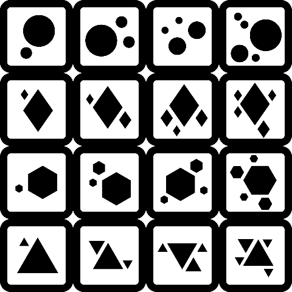
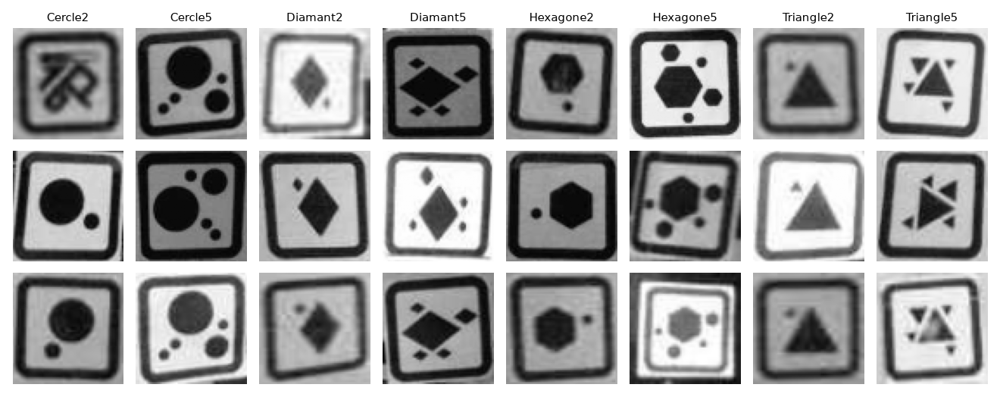
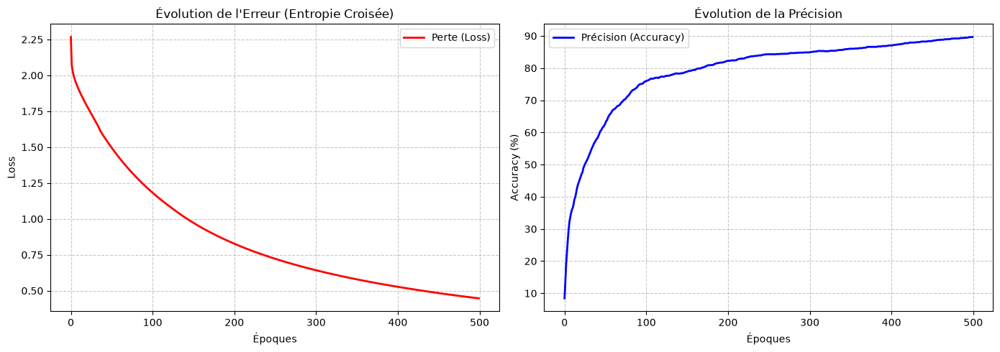
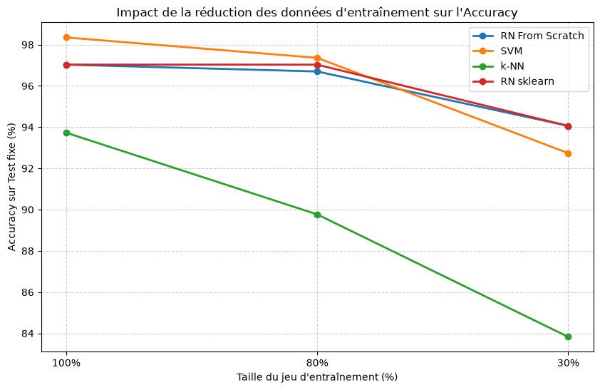
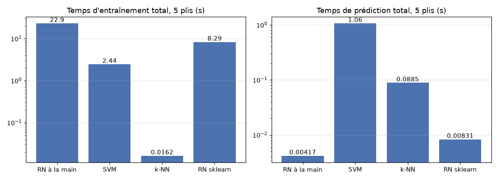

Laboratoire 2 : apprendre à reconnaître des objets

LOG635 - Systèmes intelligents et algorithmes

Groupe 01 - Équipe H

Dylan Apardian - APAD71320201 
Mathieu Delebecque - DELM80300501 
Titouan CASTRO - CAST75300401 
Fovaux pierre - FOVP87290501 

Automne 2026

## 1. Introduction

Dans ce labo, on prépare le robot à reconnaître des marqueurs ArUco à partir des photos de l'EnsembleA. On a choisi 8 symboles pour former l'EnsembleB, puis on a extrait le marqueur de chaque photo avec OpenCV. Ensuite, on compare le réseau de neurones avec trois modèles de Scikit-learn (SVM, k-NN et réseau de neurones).

Tout le code est dans le notebook `LOG635_Lab2.ipynb`. Les images traitées sont dans le dossier `EnsembleB/`, avec un dossier par symbole.

## 2. Préparation de l'EnsembleB

### 2.1 Symboles choisis

L'EnsembleA contient 16 symboles. Il y a 4 formes (cercle, diamant, hexagone, triangle) et chaque forme existe en 4 versions. Le chiffre dans le nom indique le nb de formes dans le marqueur. Par exemple, `Cercle2` a 2 cercles et `Cercle5` en a 5.

On a gardé 8 symboles, les versions à 2 et à 5 formes de chaque famille.

| Symbole | Images dans l'EnsembleA | Images où le marqueur est trouvé | Images uniques (EnsembleB) |
|---|---:|---:|---:|
| Cercle2 | 311 | 192 | 189 |
| Cercle5 | 212 | 134 | 132 |
| Diamant2 | 444 | 287 | 284 |
| Diamant5 | 203 | 160 | 159 |
| Hexagone2 | 339 | 275 | 270 |
| Hexagone5 | 271 | 153 | 150 |
| Triangle2 | 442 | 309 | 274 |
| Triangle5 | 149 | 56 | 56 |
| **Total** | **2371** | **1566** | **1514** |

### 2.2 Raison derrière nos choix

On voulait garder les 4 formes pour que le modèle apprenne vraiment à les reconnaître. Il est possible de confondre un cercle et un hexagone lorsque l'image est petite.

On a pris les versions 2 et 5 parce que ce sont les plus différentes. Il y a plusieurs formes de difference entre les version 2 et 5, donc même si une petite forme est oublié ou floue, on peut quand même les distinguer. Avec les versions 3 et 4, une seule forme non vue pourrait faire en sorte qu'on se trompe. Dans nos données, le nombre de motifs trouvé vaut en moyenne 1.8 pour les symboles « 2 » et 4.2 pour les symboles « 5 ».

On s'est limité à 8 symboles pour garder un entraînement assez court. La recherche d'hyperparamètres entraîne notre réseau 60 fois. Cela évite d'avoir des paires très similaires comme Hexagone4 et Hexagone5, qui demanderaient beaucoup plus d'exemples. Le défaut, c'est que le modèle ne reconnaît pas les 8 autres symboles. Pour l'utiliser sur le robot avec tous les marqueurs, il faudrait ajouter les 16 classes et plus d'images pour les versions 3 et 4.

## 3. Prétraitement et altérations des images

### 3.1 Prétraitement

On lit les photos 320×240 directement en grayscale.

On cherche le marqueur dans chaque photo avec OpenCV. On applique un léger flou 3×3, puis un seuillage adaptatif. Ce seuillage semble mieux marcher qu'un seuil fixe quand l'éclairage change ou qu'il y a des reflections sur le sol. On récupère ensuite tous les contours de l'image avec leur hiérarchie, cela nous permet de savoir quel contour est parmi quel contour.

Un contour est gardé comme cadre de marqueur seulement s'il passe tous ces tests.

| Test | Valeur |
|---|---|
| Ne touche pas le bord de l'image | marge de 1 px |
| Taille du côté | 20 à 110 px |
| Presque carré (largeur / hauteur) | 0.82 à 1.22 |
| Nombre de sommets | 4 à 8 |
| A un trou au centre, dont l'aire fait | 35% à 82% du cadre |
| Écart-type des gris dans le cadre | 18 ou plus |
| Intérieur plus clair que le cadre | 40 niveaux de gris de plus |
| Solidité de la plus grande forme à l'intérieur | 0.8 ou plus |

Si plusieurs contours passent, on prend celui qui contient le plus de motifs, puis le plus contrasté. Avec ces tests, on évite de prendre les cubes du robot ou un marqueur coupé par le bord de la photo.

Le marqueur trouvé est découpé avec 1 px de marge, puis redimensionné en 64×64. Maintenant toutes les images ont le même nombre de valeurs. On n'a pas fait la réduction 320×140 à 160×70 proposée dans l'énoncé, parce que le découpage autour du marqueur réduit déjà beaucoup la taille.

Quand aucun marqueur n'est trouvé, on retire la photo. On garde 1566 photos sur 2371. Triangle5 perd beaucoup plus d'images que les autres, puisqu'on n'en garde que 38%.

On a trouvé 52 images en double (35 pour Triangle2). On les retire avant l'évaluation pour éviter qu'une même image se retrouve à la fois dans l'entraînement et dans le test. L'EnsembleB final contient donc 1514 images.

Voici quelques marqeurs extraits:

L'extraction n'est pas idéale. On peut voir que la première image de Cercle2, il y a un symbole inconnu sous l'EnsembleA. On a laissé ces quelques erreurs, elles font partie du bruit des données.

### 3.2 Altérations

Toutes les images sont en grayscale. Le flou 3×3 sert seulement à trouver les contours, les pixels qu'on garde ne sont pas flous.

On n'a pas fait d'augmentation de données. Il nous reste plus de 1500 vraies photos, prises à des distances, angles et éclairages différents, et on obtient environ 95% avec ça. Si on voulait améliorer Triangle5, qui a peu d'images, ce serait la première chose à essayer (rotations, bruit, etc.).

## 4. Extraction des caractéristiques

Chaque image devient un vecteur de 4098 valeurs.

| Caractéristique | Nombre | Description |
|---|---:|---|
| Pixels du marqueur | 4096 | L'image 64×64 mise à plat, gris de 0 à 255 |
| Nombre de motifs | 1 | Nombre de formes (plus de 8 px) dans le cadre |
| Écart-type | 1 | Écart-type des gris dans le cadre, donc le contraste |

Pour notre réseau, on divise les pixels par 255 et on centre-réduit les 2 autres valeurs. La moyenne et l'écart-type viennent seulement des données d'entraînement. Pour les modèles de Scikit-learn, on utilise un `StandardScaler` ajusté sur l'entraînement de chaque pli.

Le nombre de motifs aide surtout à séparer les versions 2 et 5 d'une même forme. L'écart-type aide pour les images peu contrastées.

## 5. Réseau de neurones à la main

### 5.1 Description

| Élément | Notre choix |
|---|---|
| **Type de réseau** | Perceptron multicouche (MLP), entièrement connecté |
| **Architecture** | 4098 entrées → 1 couche cachée de 128 neurones → 8 sorties |
| **Activation cachée** | **ReLU** (on a aussi codé sigmoïde et tanh) |
| **Activation de sortie** | Softmax, qui donne une probabilité par classe |
| **Perte** | Entropie croisée, avec les étiquettes en one-hot |
| **Initialisation** | He, et les biais à 0 |
| **Optimisation** | Descente de gradient sur toutes les images à la fois |
| **Hyperparamètres finaux** | 128 neurones, taux de 0.02, 800 époques |

Pour la propagation avant, on calcule Z1=X·W1+b1, puis A1=ReLU(Z1), puis Z2=A1·W2+b2 et enfin A2=softmax(Z2).

Pour la propagation arrière, softmax et l'entropie croisée vont bien ensemble, parce que le gradient de sortie devient simplement dZ2=A2−Y. On en tire dW2=A1ᵀ·dZ2/m et db2. Ensuite, on calcule dZ1=(dZ2·W2ᵀ)×ReLU′(Z1), puis dW1=Xᵀ·dZ1/m et db1. On met à jour les poids avec W←W−taux×dW.

Le code est vectorisé. Toutes les opérations se font sur la matrice complète des images avec `np.dot` et des opérations élément par élément. Il n'y a pas de boucle sur les images ni sur les neurones. La seule boucle qui reste est celle des époques.

### 5.2 Choix des hyperparamètres

On a choisi ReLU parce qu'elle ne sature pas pour les valeurs positives, donc le gradient ne disparaît pas comme avec la sigmoïde. Elle est aussi très simple à calculer, et l'initialisation de He est faite.

Une seule couche cachée suffit pour 8 classes avec des images déjà découpées autour du marqueur. L'entraînement reste rapide.

Pour le taux d'apprentissage, on a d'abord essayé 0.05 sur 200 époques, mais les courbes sautaient beaucoup. Le taux semble être trop grand. Avec 0.005 sur 500 époques, les courbes sont mieux, mais l'apprentissage était lente. On arrive seulement à 90% sur l'entraînement après 500 époques.

On a donc testé 12 combinaisons avec une recherche par grille. On a essayé 64 ou 128 neurones, un taux de 0.005, 0.01 ou 0.02, et 400 ou 800 époques. Dans chaque pli de la validation croisée, on met 20% de l'entraînement de côté et on garde la combinaison qui a le meilleur F1 dessus. Les combinaisons choisies sont (64 ; 0.02 ; 800), (128 ; 0.02 ; 800), (128 ; 0.02 ; 800), (64 ; 0.02 ; 800) et (128 ; 0.02 ; 800). On utilise la plus fréquente, 128 neurones, taux de 0.02 et 800 époques, pour le modèle final et pour les tests de scalabilité.

## 6. Évaluation du modèle

### 6.1 Méthode

On a utilisé une validation croisée stratifiée à 5 plis sur les 1514 images, mélangées avec la graine 42.

Avec cette méthode, chaque image est testée une fois. C'est plus fiable qu'un seul découpage entraînement / test, surtout avec aussi peu d'images. La stratification garde la même proportion de chaque classe dans chaque pli, ce qui est important parce que Triangle5 n'a que 56 images. On a pris k=5 plutôt que 3 parce que ça laisse 80% des données pour l'entraînement au lieu de 67%.

Les hyperparamètres sont choisis à l'intérieur de chaque pli, et la normalisation est calculée sur l'entraînement seulement.

### 6.2 Résultats par pli

| Pli | Combinaison (neurones ; taux ; époques) | Exactitude | Précision | Rappel | F1 | Entraînement (s) | Prédiction (s) |
|---|---|---:|---:|---:|---:|---:|---:|
| 1 | 64 ; 0.02 ; 800 | 96.70% | 97.32% | 97.04% | 97.16% | 2.8 | 0.0006 |
| 2 | 128 ; 0.02 ; 800 | 96.37% | 94.79% | 95.67% | 95.12% | 5.7 | 0.0012 |
| 3 | 128 ; 0.02 ; 800 | 95.38% | 95.88% | 95.64% | 95.70% | 6.1 | 0.0011 |
| 4 | 64 ; 0.02 ; 800 | 95.71% | 96.37% | 94.05% | 95.00% | 2.7 | 0.0005 |
| 5 | 128 ; 0.02 ; 800 | 99.01% | 99.22% | 99.15% | 99.18% | 5.7 | 0.0009 |
| **Moyenne ± écart-type** | | **96.63 ± 1.43%** | **96.72 ± 1.67%** | **96.31 ± 1.91%** | **96.43 ± 1.76%** | **4.6** | **0.0008** |

### 6.3 Résultats par classe

On regroupe les prédictions des 5 plis.

| Classe | Précision | Rappel | F1 | Images |
|---|---:|---:|---:|---:|
| Cercle2 | 0.93 | 0.95 | 0.94 | 189 |
| Cercle5 | 0.98 | 0.98 | 0.98 | 132 |
| Diamant2 | 0.98 | 0.99 | 0.98 | 284 |
| Diamant5 | 0.99 | 0.95 | 0.97 | 159 |
| Hexagone2 | 0.95 | 0.97 | 0.96 | 270 |
| Hexagone5 | 0.97 | 0.95 | 0.96 | 150 |
| Triangle2 | 0.98 | 0.97 | 0.97 | 274 |
| Triangle5 | 0.95 | 0.95 | 0.95 | 56 |

Dans la matrice de confusion, chaque ligne est la vraie classe et chaque colonne est la classe prédite.

| | C2 | C5 | D2 | D5 | H2 | H5 | T2 | T5 |
|---|---:|---:|---:|---:|---:|---:|---:|---:|
| **Cercle2** | **180** | 1 | 1 | 0 | 5 | 1 | 1 | 0 |
| **Cercle5** | 0 | **129** | 0 | 0 | 1 | 1 | 1 | 0 |
| **Diamant2** | 0 | 0 | **280** | 0 | 4 | 0 | 0 | 0 |
| **Diamant5** | 0 | 0 | 2 | **151** | 2 | 1 | 2 | 1 |
| **Hexagone2** | 5 | 0 | 2 | 1 | **262** | 0 | 0 | 0 |
| **Hexagone5** | 2 | 1 | 1 | 1 | 0 | **143** | 1 | 1 |
| **Triangle2** | 6 | 0 | 1 | 0 | 1 | 0 | **265** | 1 |
| **Triangle5** | 0 | 0 | 0 | 0 | 1 | 1 | 1 | **53** |

L'erreur la plus fréquente, c'est qu'un Triangle2 est pris pour un Cercle2 (6 images). La paire la plus confondue reste Cercle2 et Hexagone2, avec 5 erreurs dans chaque sens. Si raisonnable, car en 64×64 et avec une photo floue, un hexagone peut ressembler à un cercle. Par contre, le modèle confond rarement les versions 2 et 5 d'une même forme (2 erreurs par paire max), ce qui confirme notre choix de symboles.

## 7. Modèles de Scikit-learn

On évalue les trois modèles avec les mêmes 5 plis que notre réseau, et un `StandardScaler` ajusté sur l'entraînement de chaque pli.

| Modèle | Réglages | Pourquoi |
|---|---|---|
| **SVM** | `SVC(kernel='rbf', C=10)` | Le noyau RBF permet une frontière courbe. Avec C=10, le modèle accepte moins d'erreurs d'entraînement qu'avec la valeur par défaut (1). |
| **k-NN** | `KNeighborsClassifier(n_neighbors=5, weights='distance')` | k=5 est un choix classique, ni trop sensible au bruit ni trop lissé. Les voisins les plus proches comptent plus. |
| **RN (Scikit-learn)** | `MLPClassifier(hidden_layer_sizes=(128,), activation='relu', solver='sgd', learning_rate_init=0.02, max_iter=300)` | Même architecture, même activation et même taux que notre réseau, pour comparer à réglages égaux. |

On a fixé ces réglages à la main, sans recherche par grille comme pour notre réseau. Dans les tests de scalabilité (section 8), le `MLPClassifier` utilise plutôt l'optimiseur par défaut (`adam`) avec `max_iter=400`.

## 8. Tests de scalabilité

On met d'abord 20% des images de côté pour le test, et on garde toujours les mêmes. On entraîne ensuite les modèles sur 100%, 80% puis 30% du reste. Les sous-ensembles gardent les proportions des classes. Notre réseau utilise la combinaison finale (128 ; 0.02 ; 800).

Exactitude sur les 303 images de test:

| Modèle | 100% (1211 images) | 80% (968 images) | 30% (363 images) | Perte de 100% à 30% |
|---|---:|---:|---:|---:|
| RN fait à la main | 97.03% | 96.70% | 94.06% | −2.97 pts |
| RN Scikit-learn | 97.03% | 97.03% | 94.06% | −2.97 pts |
| SVM | 98.35% | 97.36% | 92.74% | −5.61 pts |
| k-NN | 93.73% | 89.77% | 83.83% | −9.90 pts |

## 9. Comparaison des résultats

### 9.1 Performances (validation croisée à 5 plis)

Moyennes macro sur les 5 plis:

| Modèle | Exactitude | Précision | Rappel | F1 |
|---|---:|---:|---:|---:|
| RN à la main | **96.63%** | 96.72% | **96.31%** | **96.43%** |
| SVM | 96.50% | **96.90%** | 95.79% | 96.24% |
| k-NN | 89.50% | 92.19% | 87.40% | 89.26% |
| RN Scikit-learn | 95.64% | 95.53% | 95.24% | 95.34% |

Notre réseau obtient 96.63% d'exactitude et 96.43% de F1. C'est un peu au-dessus du SVM (0.13 pt en exactitude et 0.19 pt en F1) et du réseau de Scikit-learn (0.99 pt en exactitude et 1.09 pt en F1). Ces écarts sont plus petits que la variation d'un pli à l'autre (1.4 pt), donc on peut dire que notre propagation avant et notre rétropropagation fonctionnent bien.

Le SVM et les deux réseaux dépassent tous 95%. Le k-NN est nettement derrière avec 89.50%. Avec 4098 valeurs par image, la distance entre deux images ne veut plus dire grand-chose, et un marqueur un peu décalé dans l'image suffit à l'éloigner des autres images de sa classe.

### 9.2 Temps d'entraînement et de prédiction

| Modèle | Entraînement total, 5 plis (s) | Entraînement par pli (s) | Prédiction totale, 5 plis (s) | Prédiction par image (ms) |
|---|---:|---:|---:|---:|
| RN fait à la main | 22.95 | 4.59 | **0.004** | **0.003** |
| SVM | 2.44 | 0.49 | 1.062 | 0.701 |
| k-NN | 0.016 | 0.003 | 0.088 | 0.058 |
| RN Scikit-learn | 8.29 | 1.66 | 0.008 | 0.005 |

Chaque modèle prédit les 1514 images une fois au total. Le temps de notre réseau ne compte pas la recherche d'hyperparamètres.

Pour l'entraînement, le kNN ne fait presque rien, il semble garder les données en mémoire. Notre réseau est le plus lent, avec environ 4.6s par pli. Il fait toujours 800 époques sur toutes les images, sans optimiseur avancé et sans s'arrêter plus tôt. Le réseau de Scikit-learn, s'arrête quand la perte ne s'améliore plus.

Pour la prédiction, les réseaux sont les plus rapides (0.003 et 0.005ms par image), puisqu'il suffit de deux multiplications de matrices. Le SVM est le plus lent (0.7ms par image), parce qu'il doit comparer chaque image à tous ses vecteurs de support. Le kNN n'a presque pas d'entraînement, mais il prédit environ 10 à 20 fois plus lentement que les réseaux, il compare chaque image à toutes les images d'entraînement.

### 9.3 Scalabilité

Le SVM a la meilleure exactitude à 100% (98.35%) et à 80% (97.36%). Avec seulement 30% des données, ce sont les deux réseaux qui sont en tête, à égalité avec 94.06%. Ils perdent environ 3 points chacun.

Le kNN passe de 93.73% à 83.83%, 9.9 points de moins. Avec moins d'exemples, ses voisins les plus proches sont plus souvent d'une autre classe. Le SVM perd 5.6 points à 30% (92.74%). Avec peu d'exemples, il a moins de vecteurs de support pour bien placer sa frontière.

Le test ne contient que 303 images, donc une image vaut 0.33 point. À 100%, l'écart de 1.3 point entre le SVM et les réseaux représente 4 images, ce qui n'est pas catastrophique. On n'a fait qu'un seul découpage, et les réglages de notre réseau viennent d'une validation croisée qui contenait déjà ces 303 images, ce qui peut l'avantager un peu.

## 10. Conclusion

Dans notre cas, les réseaux de neurones sont le meilleur choix pour ce problème. Ils atteignent 95.6 à 96.6%, ils perdent le moins quand on réduit les données et ils prédisent le plus vite (moins de 0.01ms par image), ce qui est pratique sur le robot. Leur entraînement est plus long, mais on ne le fait qu'une fois d'avance.

Le SVM a un F1 de 96.24% en validation croisée, presque à égal avec notre réseau, et c'est lui qui fait le mieux dans le test de scalabilité à 100% et 80%. Par contre, il prédit beaucoup plus lentement que notre réseau et perd plus quand il a peu de données.

Le kNN est le moins adapté. Il est moins précis avec environ 90% et c'est lui qui souffre le plus du manque de données, à cause du grand nombre de pixels.

Notre réseau en NumPy fait un peu mieux que les modèles de Scikit-learn en validation croisée, et il est à égalité avec le réseau de Scikit-learn dans le test à 30%. Par contre, il est plus long à entraîner.

Il y a quelques limites. L'extraction du marqueur rejette 34% des photos et la confusion entre Cercle2 et Hexagone2 reste la principale source d'erreurs. Pour améliorer ça, on pourrait ajouter de l'augmentation de données ou utiliser une image plus grande que 64×64.
